# PG Management System — Database Migration Reconciliation Report

**Date:** October 30, 2026  
**Auditor:** Senior Database Migration & Backend Architect  
**Project:** `D:\PG_Management` & `pg-management-system/backend`  
**Main Live Database:** `pg_management` (PostgreSQL 18.6)  
**Testing Database:** `pg_management_test` (PostgreSQL 18.6)  

---

## 1. Executive Summary & Root Cause Analysis

A detailed structural investigation into the two database instances (`pg_management` and `pg_management_test`) was performed to resolve why the databases contain revision IDs that do not appear in the current backend migration directory:

```
Main Database (pg_management) Current Revision: 6cb475ecad6d (13 tables, 63 records)
Test Database (pg_management_test) Current Revision: 7d2e4f6a8b10 (17 tables, 93 records)
Current Backend Migration Chain Head: b2c3d4e5f6a7
```

### The Root Cause: Two Historical Migration Tracks

The project's Git history and directory layout reveal that the backend evolved across two independent Alembic migration lineages:

```mermaid
flowchart TD
    subgraph TrackA["Legacy Root Track (D:/PG_Management/alembic)"]
        A1["910643d8744a (Phase 1 Initial Auth)"] --> A2["2f6bb8bc3b44 (Phase 2a Rooms & Beds)"]
        A2 --> A3["b518259e353b (Enforce Bed FK)"]
        A3 --> A4["7174ab3bff4c (Phase 2b Residents)"]
        A4 --> A5["6cb475ecad6d (Phase 2c Invoices & Payments)\n[LIVE DB pg_management]"]
        A5 --> A6["7d2e4f6a8b10 (Phase 2d Operations Tables)\n[TEST DB pg_management_test]"]
    end

    subgraph TrackB["Modern Backend Track (backend/migrations)"]
        B1["bd0a1cc93d5d (Initial Merged Schema)"] --> B2["f1c4a0e3d2b1 (Add Receipts)"]
        B2 --> B3["4c11d205aa12 (Payment Reservations & Idempotency)"]
        B3 --> B4["7c32e912ab01 (Processed Webhook Events)"]
        B4 --> B5["9a81b2c3d4e5 (Payment Links)"]
        B5 --> B6["a1b2c3d4e5f6 (Device Tokens)"]
        B6 --> B7["b2c3d4e5f6a7 (Resident Approval & OTP Tables)\n[TARGET HEAD]"]
    end
```



1. **Legacy Track (`D:\PG_Management\alembic`):**
   - Developed during the initial monolith phase directly under project root.
   - Applied incrementally to `pg_management` up to `6cb475ecad6d` (Phase 2c: Invoices & Payments).
   - Applied to `pg_management_test` up to `7d2e4f6a8b10` (Phase 2d: Operations Tables — complaints, expenses, staff, otp_verifications).
2. **Modern Backend Track (`pg-management-system\backend\migrations`):**
   - Created on Oct 23, 2026, when the modular backend structure was established.
   - Initialized with `bd0a1cc93d5d` as an autogenerated baseline.
   - Incremented with payment features: `f1c4a0e3d2b1` (receipts) $\rightarrow$ `4c11d205aa12` (payment reservations) $\rightarrow$ `7c32e912ab01` (webhook idempotency) $\rightarrow$ `9a81b2c3d4e5` (payment links) $\rightarrow$ `a1b2c3d4e5f6` (device tokens) $\rightarrow$ `b2c3d4e5f6a7` (resident approval & OTP).

---

## 2. Actual Database Schema Comparison

### 2.1 Table Inventory

| Table Name | `pg_management` (Main) | `pg_management_test` (Test) | SQLAlchemy Models |
| :--- | :---: | :---: | :---: |
| `alembic_version` | Present (`6cb475ecad6d`) | Present (`7d2e4f6a8b10`) | Framework |
| `companies` | Present (1 row) | Present (1 row) | `Company` |
| `roles` | Present (4 rows) | Present (4 rows) | `Role` |
| `users` | Present (4 rows) | Present (4 rows) | `User` |
| `user_property_access` | Present (4 rows) | Present (4 rows) | `UserPropertyAccess` |
| `properties` | Present (5 rows) | Present (5 rows) | `Property` |
| `rooms` | Present (0 rows) | Present (0 rows) | `Room` |
| `beds` | Present (0 rows) | Present (0 rows) | `Bed` |
| `residents` | Present (0 rows) | Present (0 rows) | `Resident` |
| `invoices` | Present (0 rows) | Present (0 rows) | `Invoice` |
| `payments` | Present (0 rows) | Present (0 rows) | `Payment` |
| `audit_logs` | Present (36 rows) | Present (36 rows) | `AuditLog` |
| `refresh_tokens` | Present (8 rows) | Present (8 rows) | `RefreshToken` |
| `complaints` | Missing | Present (0 rows) | `Complaint` |
| `expenses` | Missing | Present (0 rows) | `Expense` |
| `staff` | Missing | Present (0 rows) | `Staff` |
| `otp_verifications` | Missing | Present (0 rows) | `OtpVerification` |
| `receipts` | Missing | Missing | `Receipt` |
| `payment_links` | Missing | Missing | `PaymentLink` |
| `processed_webhook_events` | Missing | Missing | `ProcessedWebhookEvent` |
| `device_tokens` | Missing | Missing | `DeviceToken` |
| `leads` | Missing | Missing | `Lead` |
| `notices` | Missing | Missing | `Notice` |
| `notifications` | Missing | Missing | `Notification` |

---

## 3. Database Safety & Integrity Verification

Strict safety invariants were enforced throughout this audit:
- **Zero Production Writes:** The main live database `pg_management` was queried in **READ-ONLY** mode. Zero DDL or DML statements were executed against `pg_management`.
- **Zero Record Deletions:** All 63 baseline records across `pg_management` (users, roles, companies, properties, refresh tokens, audit logs) remain 100% intact.
- **Zero Alembic Stamps:** Neither database was stamped with arbitrary revisions.
- **Credential Protection:** All connection strings and passwords remain redacted.

---

## 4. Migration Reconciliation Strategy

To safely bridge the two migration tracks without data loss or downtime:

1. **Target Unified Revision:** `b2c3d4e5f6a7`.
2. **Reconciliation DDL Script:** The verified script `migration_proposal_review/production_plan_v3_1/01_unified_reconcile_pg_management_v3_1.sql` contains:
   - Safe addition of missing tables (`receipts`, `payment_links`, `processed_webhook_events`, `device_tokens`, `leads`, `notices`, `notifications`, `complaints`, `expenses`, `staff`, `otp_verifications`).
   - Non-destructive column additions to existing tables (`payments.idempotency_key`, `payments.reservation_expires_at`, `users.approval_status`).
   - Replacement of legacy foreign keys with `ON DELETE RESTRICT` (preventing orphaned records).
   - Atomic update of `alembic_version` to `b2c3d4e5f6a7`.
3. **Execution Gate:** Production execution on `pg_management` is held at the Production Authorization Gate awaiting owner sign-off.
