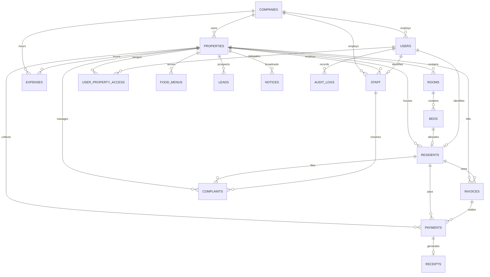

# Origin PG Management System – Admin & Owner Database Schema Specification
**Database:** PostgreSQL 16+ | **Alembic Revision Head:** `a7b8c9d0e1f2` | **Precision:** `NUMERIC(10, 2)`

---

## 1. Entity-Relationship Overview

---

## 2. Table Specifications & Data Dictionaries

### 2.1 Table: `companies`
Represents the enterprise entity running PG properties.
| Column | Type | Nullable | Constraints & Defaults | Description |
| :--- | :--- | :--- | :--- | :--- |
| `id` | `UUID` | No | Primary Key | Company unique identifier |
| `name` | `VARCHAR(150)` | No | | Legal company name |
| `code` | `VARCHAR(50)` | No | UNIQUE, INDEX | Identifier code (e.g. `SMARTPG`) |
| `email` | `VARCHAR(255)` | Yes | | Enterprise contact email |
| `phone` | `VARCHAR(30)` | Yes | | Enterprise contact phone |
| `address` | `TEXT` | Yes | | Registered corporate address |
| `tax_id` | `VARCHAR(50)` | Yes | | GSTIN or corporate tax ID |
| `subscription_plan` | `VARCHAR(50)` | No | DEFAULT `'STANDARD'` | Tier: `STANDARD`, `ENTERPRISE`, `UNLIMITED` |
| `subscription_status` | `VARCHAR(50)` | No | DEFAULT `'ACTIVE'` | Status: `ACTIVE`, `SUSPENDED`, `TRIAL` |
| `is_active` | `BOOLEAN` | No | DEFAULT `TRUE` | Soft-deletion flag |
| `created_at` | `TIMESTAMPTZ` | No | DEFAULT `NOW()` | Timestamp created |
| `updated_at` | `TIMESTAMPTZ` | No | DEFAULT `NOW()` | Timestamp updated |

---

### 2.2 Table: `properties`
Physical PG buildings / hostels operated by the company.
| Column | Type | Nullable | Constraints & Defaults | Description |
| :--- | :--- | :--- | :--- | :--- |
| `id` | `UUID` | No | Primary Key | Property unique identifier |
| `company_id` | `UUID` | No | FK $\to$ `companies.id` ON DELETE CASCADE | Parent enterprise entity |
| `name` | `VARCHAR(150)` | No | | Property name |
| `code` | `VARCHAR(50)` | No | UNIQUE, INDEX | Short code (e.g. `SCH01`) |
| `property_type` | `VARCHAR(50)` | No | DEFAULT `'COLIVING'` | `MENS`, `LADIES`, `COLIVING` |
| `address_line1` | `VARCHAR(255)` | No | | Physical street address |
| `address_line2` | `VARCHAR(255)` | Yes | | Floor/suite/locality |
| `city` | `VARCHAR(100)` | No | INDEX | City location |
| `state` | `VARCHAR(100)` | No | | State |
| `pincode` | `VARCHAR(20)` | No | | Postal code |
| `contact_phone` | `VARCHAR(30)` | Yes | | Manager telephone |
| `contact_email` | `VARCHAR(255)` | Yes | | Manager contact email |
| `total_floors` | `INTEGER` | No | DEFAULT `1` | Building floor count |
| `description` | `TEXT` | Yes | | Marketing description |
| `amenities` | `JSON` | No | DEFAULT `'[]'` | JSON array of amenity tags |
| `rules` | `JSON` | No | DEFAULT `'[]'` | JSON array of house rules |
| `is_active` | `BOOLEAN` | No | DEFAULT `TRUE` | Operational flag |
| `created_at` | `TIMESTAMPTZ` | No | DEFAULT `NOW()` | Timestamp created |
| `updated_at` | `TIMESTAMPTZ` | No | DEFAULT `NOW()` | Timestamp updated |

---

### 2.3 Table: `rooms`
Rooms within each property.
| Column | Type | Nullable | Constraints & Defaults | Description |
| :--- | :--- | :--- | :--- | :--- |
| `id` | `UUID` | No | Primary Key | Room unique identifier |
| `property_id` | `UUID` | No | FK $\to$ `properties.id` ON DELETE CASCADE | Parent building |
| `floor_number` | `INTEGER` | No | DEFAULT `1`, INDEX | Floor number |
| `room_number` | `VARCHAR(50)` | No | INDEX | e.g. `101`, `204-B` |
| `room_type` | `VARCHAR(50)` | No | DEFAULT `'DOUBLE_SHARING'` | `SINGLE`, `DOUBLE`, `TRIPLE`, `FOUR` |
| `base_monthly_rent`| `NUMERIC(10, 2)`| No | DEFAULT `0.00` | Standard monthly tariff |
| `deposit_amount` | `NUMERIC(10, 2)`| No | DEFAULT `0.00` | Standard security deposit |
| `is_active` | `BOOLEAN` | No | DEFAULT `TRUE` | Available flag |
| `amenities` | `JSON` | No | DEFAULT `'{}'` | Room features (AC, balcony) |
| `created_at` | `TIMESTAMPTZ` | No | DEFAULT `NOW()` | Timestamp created |
| `updated_at` | `TIMESTAMPTZ` | No | DEFAULT `NOW()` | Timestamp updated |

---

### 2.4 Table: `beds`
Individual bed spaces for resident allocation.
| Column | Type | Nullable | Constraints & Defaults | Description |
| :--- | :--- | :--- | :--- | :--- |
| `id` | `UUID` | No | Primary Key | Bed unique identifier |
| `room_id` | `UUID` | No | FK $\to$ `rooms.id` ON DELETE CASCADE | Parent room |
| `property_id` | `UUID` | Yes | FK $\to$ `properties.id` ON DELETE CASCADE | Direct property linkage |
| `bed_number` | `VARCHAR(50)` | No | INDEX | e.g. `101-A`, `101-B` |
| `status` | `VARCHAR(50)` | No | DEFAULT `'AVAILABLE'`, INDEX | `AVAILABLE`, `OCCUPIED`, `MAINTENANCE` |
| `monthly_rent` | `NUMERIC(10, 2)`| Yes | | Custom bed rent override |
| `is_active` | `BOOLEAN` | No | DEFAULT `TRUE` | Active allocation flag |
| `created_at` | `TIMESTAMPTZ` | No | DEFAULT `NOW()` | Timestamp created |
| `updated_at` | `TIMESTAMPTZ` | No | DEFAULT `NOW()` | Timestamp updated |

---

### 2.5 Table: `residents`
Tenants residing in the PG property.
| Column | Type | Nullable | Constraints & Defaults | Description |
| :--- | :--- | :--- | :--- | :--- |
| `id` | `UUID` | No | Primary Key | Resident profile identifier |
| `user_id` | `UUID` | No | FK $\to$ `users.id` ON DELETE CASCADE, UNIQUE | Linked auth user account |
| `property_id` | `UUID` | No | FK $\to$ `properties.id` ON DELETE RESTRICT | Allocated property |
| `room_id` | `UUID` | Yes | FK $\to$ `rooms.id` ON DELETE SET NULL | Allocated room |
| `bed_id` | `UUID` | Yes | FK $\to$ `beds.id` ON DELETE SET NULL, UNIQUE | Allocated bed |
| `check_in_date` | `DATE` | No | | Move-in date |
| `expected_check_out_date`| `DATE` | Yes | | Notice/departure date |
| `actual_check_out_date` | `DATE` | Yes | | Final settlement checkout date |
| `monthly_rent` | `NUMERIC(10, 2)`| No | DEFAULT `0.00` | Agreed monthly rent |
| `security_deposit` | `NUMERIC(10, 2)`| No | DEFAULT `0.00` | Deposit held |
| `status` | `VARCHAR(50)` | No | DEFAULT `'ACTIVE'`, INDEX | `ACTIVE`, `NOTICE_PERIOD`, `CHECKED_OUT` |
| `kyc_status` | `VARCHAR(50)` | No | DEFAULT `'PENDING'`, INDEX | `PENDING`, `VERIFIED`, `REJECTED` |
| `id_proof_type` | `VARCHAR(50)` | Yes | | `AADHAAR`, `PAN`, `PASSPORT`, `DL` |
| `id_proof_number_masked`| `VARCHAR(50)`| Yes | | Masked document number |
| `date_of_birth` | `DATE` | Yes | | DOB |
| `gender` | `VARCHAR(20)` | Yes | | Gender |
| `occupation` | `VARCHAR(100)` | Yes | | Professional / Student status |
| `emergency_contact_name`| `VARCHAR(150)`| Yes | | Next of kin contact name |
| `emergency_contact_phone`| `VARCHAR(30)`| Yes | | Next of kin phone |
| `pincode` | `VARCHAR(20)` | Yes | | Permanent address pincode |
| `created_at` | `TIMESTAMPTZ` | No | DEFAULT `NOW()` | Timestamp created |
| `updated_at` | `TIMESTAMPTZ` | No | DEFAULT `NOW()` | Timestamp updated |

---

### 2.6 Table: `invoices`
Billing statements issued to residents.
| Column | Type | Nullable | Constraints & Defaults | Description |
| :--- | :--- | :--- | :--- | :--- |
| `id` | `UUID` | No | Primary Key | Invoice identifier |
| `property_id` | `UUID` | No | FK $\to$ `properties.id` ON DELETE CASCADE | Associated property |
| `resident_id` | `UUID` | No | FK $\to$ `residents.id` ON DELETE CASCADE | Billed tenant |
| `invoice_number`| `VARCHAR(100)`| No | UNIQUE, INDEX | e.g. `INV-202611-A1B2C3` |
| `billing_month` | `VARCHAR(7)` | No | INDEX | Format `YYYY-MM` |
| `invoice_type` | `VARCHAR(50)` | No | DEFAULT `'RENT'` | `RENT`, `SECURITY_DEPOSIT`, `CHARGES` |
| `amount` | `NUMERIC(10, 2)`| No | | Total invoiced amount |
| `paid_amount` | `NUMERIC(10, 2)`| No | DEFAULT `0.00` | Cumulative settled payments |
| `due_date` | `DATE` | No | | Payment deadline |
| `status` | `VARCHAR(50)` | No | DEFAULT `'PENDING'`, INDEX | `PENDING`, `PARTIALLY_PAID`, `PAID`, `CANCELLED` |
| `notes` | `TEXT` | Yes | | Special billing remarks |
| `created_at` | `TIMESTAMPTZ` | No | DEFAULT `NOW()` | Timestamp created |
| `updated_at` | `TIMESTAMPTZ` | No | DEFAULT `NOW()` | Timestamp updated |

---

### 2.7 Table: `payments`
Financial collections from residents (online gateway & offline).
| Column | Type | Nullable | Constraints & Defaults | Description |
| :--- | :--- | :--- | :--- | :--- |
| `id` | `UUID` | No | Primary Key | Payment transaction ID |
| `property_id` | `UUID` | No | FK $\to$ `properties.id` ON DELETE CASCADE | Property collecting funds |
| `resident_id` | `UUID` | No | FK $\to$ `residents.id` ON DELETE CASCADE | Paying resident |
| `invoice_id` | `UUID` | No | FK $\to$ `invoices.id` ON DELETE CASCADE | Settled invoice |
| `payment_number`| `VARCHAR(100)`| No | UNIQUE, INDEX | e.g. `PAY-COL-20261102-1A2B` |
| `idempotency_key`| `VARCHAR(128)`| Yes | UNIQUE, INDEX | Distributed idempotency token |
| `amount` | `NUMERIC(10, 2)`| No | | Collected amount |
| `payment_mode` | `VARCHAR(50)` | No | | `CASH`, `BANK_TRANSFER`, `UPI`, `CARD` |
| `gateway_order_id`| `VARCHAR(150)`| Yes | INDEX | Razorpay or offline reference |
| `gateway_payment_id`| `VARCHAR(150)`| Yes | INDEX | Gateway payment ID or UTR |
| `status` | `VARCHAR(50)` | No | DEFAULT `'INITIATED'`, INDEX | `INITIATED`, `SUCCESS`, `FAILED`, `REFUNDED` |
| `paid_at` | `TIMESTAMPTZ` | Yes | | Date/time payment settled |
| `created_at` | `TIMESTAMPTZ` | No | DEFAULT `NOW()` | Timestamp created |
| `updated_at` | `TIMESTAMPTZ` | No | DEFAULT `NOW()` | Timestamp updated |

---

### 2.8 Table: `receipts`
Digital payment receipts issued upon successful settlement.
| Column | Type | Nullable | Constraints & Defaults | Description |
| :--- | :--- | :--- | :--- | :--- |
| `id` | `UUID` | No | Primary Key | Receipt identifier |
| `payment_id` | `UUID` | No | FK $\to$ `payments.id` ON DELETE CASCADE, UNIQUE | Settled payment transaction |
| `invoice_id` | `UUID` | No | FK $\to$ `invoices.id` ON DELETE CASCADE | Associated invoice |
| `receipt_number`| `VARCHAR(100)`| No | UNIQUE, INDEX | e.g. `RCT-COL-20261102-3D4E` |
| `amount` | `NUMERIC(10, 2)`| No | | Settled receipt amount |
| `issued_at` | `TIMESTAMPTZ` | No | DEFAULT `NOW()` | Timestamp issued |
| `whatsapp_status`| `VARCHAR(50)` | No | DEFAULT `'PENDING'` | Delivery status |
| `created_at` | `TIMESTAMPTZ` | No | DEFAULT `NOW()` | Timestamp created |
| `updated_at` | `TIMESTAMPTZ` | No | DEFAULT `NOW()` | Timestamp updated |

---

### 2.9 Table: `expenses`
Property operational expenditures.
| Column | Type | Nullable | Constraints & Defaults | Description |
| :--- | :--- | :--- | :--- | :--- |
| `id` | `UUID` | No | Primary Key | Expense identifier |
| `company_id` | `UUID` | No | FK $\to$ `companies.id` ON DELETE CASCADE | Enterprise entity |
| `property_id` | `UUID` | Yes | FK $\to$ `properties.id` ON DELETE CASCADE | Associated building |
| `created_by_id` | `UUID` | Yes | FK $\to$ `users.id` ON DELETE SET NULL | Author user ID |
| `category` | `VARCHAR(50)` | No | INDEX | `GROCERIES`, `UTILITIES`, `MAINTENANCE`, `SALARY` |
| `title` | `VARCHAR(200)` | No | | Brief description |
| `amount` | `NUMERIC(10, 2)`| No | | Expense amount |
| `method` | `VARCHAR(50)` | No | DEFAULT `'UPI'` | Payment method |
| `date` | `DATE` | No | INDEX | Expenditure date |
| `notes` | `TEXT` | Yes | | Operational remarks |
| `created_at` | `TIMESTAMPTZ` | No | DEFAULT `NOW()` | Timestamp created |
| `updated_at` | `TIMESTAMPTZ` | No | DEFAULT `NOW()` | Timestamp updated |

---

### 2.10 Table: `staff`
Staff profiles employed across properties.
| Column | Type | Nullable | Constraints & Defaults | Description |
| :--- | :--- | :--- | :--- | :--- |
| `id` | `UUID` | No | Primary Key | Staff identifier |
| `company_id` | `UUID` | No | FK $\to$ `companies.id` ON DELETE CASCADE | Enterprise company |
| `property_id` | `UUID` | Yes | FK $\to$ `properties.id` ON DELETE SET NULL | Assigned property |
| `user_id` | `UUID` | Yes | FK $\to$ `users.id` ON DELETE SET NULL, UNIQUE | Associated login account |
| `name` | `VARCHAR(150)` | No | | Full name |
| `role` | `VARCHAR(100)` | No | DEFAULT `'PROPERTY_MANAGER'` | Designation |
| `phone` | `VARCHAR(30)` | No | | Mobile number |
| `email` | `VARCHAR(255)` | Yes | | Email |
| `salary` | `NUMERIC(10, 2)`| No | DEFAULT `0.00` | Monthly compensation |
| `joining_date` | `DATE` | Yes | | Employment start date |
| `is_active` | `BOOLEAN` | No | DEFAULT `TRUE` | Employment status flag |
| `availability_hours`| `VARCHAR(100)`| Yes | DEFAULT `'9:00 AM - 6:00 PM'` | Work shift hours |
| `is_emergency_contact`| `BOOLEAN`| No | DEFAULT `FALSE` | High-priority responder flag |
| `created_at` | `TIMESTAMPTZ` | No | DEFAULT `NOW()` | Timestamp created |
| `updated_at` | `TIMESTAMPTZ` | No | DEFAULT `NOW()` | Timestamp updated |

---

### 2.11 Table: `food_menus`
Weekly food schedule for PG residents.
| Column | Type | Nullable | Constraints & Defaults | Description |
| :--- | :--- | :--- | :--- | :--- |
| `id` | `UUID` | No | Primary Key | Menu item identifier |
| `property_id` | `UUID` | No | FK $\to$ `properties.id` ON DELETE CASCADE, INDEX | Associated building |
| `day_of_week` | `VARCHAR(10)` | No | | `MONDAY` through `SUNDAY` |
| `meal_type` | `VARCHAR(20)` | No | | `BREAKFAST`, `LUNCH`, `DINNER` |
| `start_time` | `VARCHAR(10)` | Yes | | Meal service start time |
| `end_time` | `VARCHAR(10)` | Yes | | Meal service end time |
| `dishes` | `JSON` | No | DEFAULT `'[]'` | List of food items |
| `is_active` | `BOOLEAN` | No | DEFAULT `TRUE` | Active schedule flag |
| `created_at` | `TIMESTAMPTZ` | No | DEFAULT `NOW()` | Timestamp created |
| `updated_at` | `TIMESTAMPTZ` | No | DEFAULT `NOW()` | Timestamp updated |

---

### 2.12 Table: `leads`
Prospective tenant CRM pipeline.
| Column | Type | Nullable | Constraints & Defaults | Description |
| :--- | :--- | :--- | :--- | :--- |
| `id` | `UUID` | No | Primary Key | Lead identifier |
| `property_id` | `UUID` | No | FK $\to$ `properties.id` ON DELETE CASCADE, INDEX | Target property |
| `name` | `VARCHAR(150)` | No | | Prospective tenant name |
| `phone` | `VARCHAR(30)` | No | INDEX | Telephone |
| `email` | `VARCHAR(255)` | Yes | | Email |
| `status` | `VARCHAR(50)` | No | DEFAULT `'NEW'`, INDEX | `NEW`, `CONTACTED`, `VISIT_SCHEDULED`, `BOOKED`, `LOST` |
| `source` | `VARCHAR(100)` | Yes | | `WEBSITE`, `WALK_IN`, `REFERRAL` |
| `requirement` | `TEXT` | Yes | | Room preference description |
| `visit_date` | `TIMESTAMPTZ` | Yes | | Scheduled visit timestamp |
| `follow_up_date`| `TIMESTAMPTZ` | Yes | | Follow-up reminder |
| `notes` | `TEXT` | Yes | | CRM interaction notes |
| `created_at` | `TIMESTAMPTZ` | No | DEFAULT `NOW()` | Timestamp created |
| `updated_at` | `TIMESTAMPTZ` | No | DEFAULT `NOW()` | Timestamp updated |

---

### 2.13 Table: `complaints`
Maintenance complaints and ticketing.
| Column | Type | Nullable | Constraints & Defaults | Description |
| :--- | :--- | :--- | :--- | :--- |
| `id` | `UUID` | No | Primary Key | Complaint ticket ID |
| `property_id` | `UUID` | No | FK $\to$ `properties.id` ON DELETE CASCADE, INDEX | Associated building |
| `resident_id` | `UUID` | No | FK $\to$ `residents.id` ON DELETE CASCADE, INDEX | Originating resident |
| `assigned_staff_id`| `UUID` | Yes | FK $\to$ `staff.id` ON DELETE SET NULL, INDEX | Assigned technician/warden |
| `category` | `VARCHAR(50)` | No | DEFAULT `'OTHER'` | `ELECTRICAL`, `PLUMBING`, `CLEANING`, `WIFI`, etc. |
| `title` | `VARCHAR(200)` | No | | Brief issue summary |
| `description` | `TEXT` | No | | Full description |
| `priority` | `VARCHAR(30)` | No | DEFAULT `'MEDIUM'` | `LOW`, `MEDIUM`, `HIGH`, `EMERGENCY` |
| `status` | `VARCHAR(50)` | No | DEFAULT `'PENDING'`, INDEX | `PENDING`, `ASSIGNED`, `IN_PROGRESS`, `RESOLVED`, `CLOSED` |
| `resolution_notes`| `TEXT` | Yes | | Resolution audit notes |
| `photo_path` | `VARCHAR(512)` | Yes | | Attached photo URL |
| `resolved_at` | `TIMESTAMPTZ` | Yes | | Timestamp of resolution |
| `created_at` | `TIMESTAMPTZ` | No | DEFAULT `NOW()` | Timestamp created |
| `updated_at` | `TIMESTAMPTZ` | No | DEFAULT `NOW()` | Timestamp updated |

---

### 2.14 Table: `notices`
Broadcast announcements for properties.
| Column | Type | Nullable | Constraints & Defaults | Description |
| :--- | :--- | :--- | :--- | :--- |
| `id` | `UUID` | No | Primary Key | Notice ID |
| `property_id` | `UUID` | No | FK $\to$ `properties.id` ON DELETE CASCADE, INDEX | Recipient property |
| `created_by_user_id`| `UUID` | No | FK $\to$ `users.id` ON DELETE RESTRICT | Author admin user |
| `title` | `VARCHAR(200)` | No | | Headline |
| `content` | `TEXT` | No | | Notice body text |
| `is_pinned` | `BOOLEAN` | No | DEFAULT `FALSE` | Pinned announcement flag |
| `expires_at` | `TIMESTAMPTZ` | Yes | | Auto-expiration date |
| `created_at` | `TIMESTAMPTZ` | No | DEFAULT `NOW()` | Timestamp created |
| `updated_at` | `TIMESTAMPTZ` | No | DEFAULT `NOW()` | Timestamp updated |

---

### 2.15 Table: `otp_verifications`
Authentication security and Super Key 2FA tokens.
| Column | Type | Nullable | Constraints & Defaults | Description |
| :--- | :--- | :--- | :--- | :--- |
| `id` | `UUID` | No | Primary Key | Verification record ID |
| `phone` | `VARCHAR(30)` | Yes | INDEX | Normalized mobile number |
| `email` | `VARCHAR(255)` | Yes | INDEX | Normalized admin email address |
| `otp_hash` | `VARCHAR(255)` | No | | HMAC-SHA256 salted hash |
| `salt` | `VARCHAR(64)` | No | | 32-hex cryptographic salt |
| `purpose` | `VARCHAR(50)` | No | INDEX | `ADMIN_LOGIN`, `ADMIN_REGISTRATION`, `RESIDENT_LOGIN` |
| `attempts` | `INTEGER` | No | DEFAULT `0` | Failed attempts count |
| `max_attempts` | `INTEGER` | No | DEFAULT `3` | Lockout threshold |
| `expires_at` | `TIMESTAMPTZ` | No | INDEX | Expiration timestamp (10 min) |
| `is_verified` | `BOOLEAN` | No | DEFAULT `FALSE`, INDEX | Consumed flag |
| `created_at` | `TIMESTAMPTZ` | No | DEFAULT `NOW()` | Timestamp created |
| `updated_at` | `TIMESTAMPTZ` | No | DEFAULT `NOW()` | Timestamp updated |
