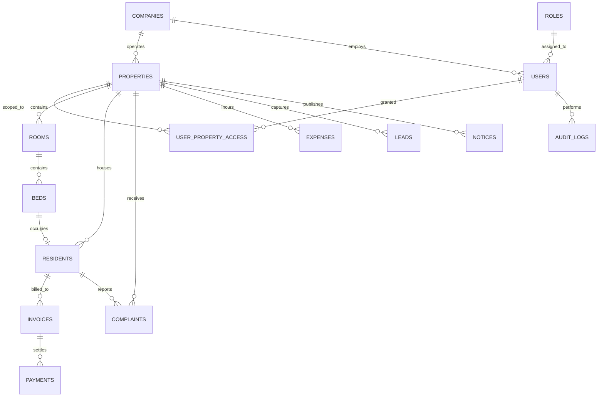

# Database Architecture Specification

## Overview

The database is powered by **PostgreSQL 16+** using **SQLAlchemy 2.x** with **Psycopg 3** as the binary driver. All primary keys use RFC 4122 UUIDv4 identifiers to prevent sequential ID harvesting and enumeration attacks across multi-client applications.

Financial values are stored in fixed-precision integer paise (`BIGINT`) or `NUMERIC(12, 2)` to avoid floating-point inaccuracies.

---

## Entity Relationship Overview

---

## Core Entities & Tables

### 1. `companies`
Root multi-property operating entity.
- `id` (UUID, PK)
- `name` (VARCHAR 150)
- `code` (VARCHAR 50, UNIQUE)
- `email` (VARCHAR 255)
- `phone` (VARCHAR 30)
- `address` (TEXT)
- `tax_id` (VARCHAR 50, GSTIN / PAN)
- `is_active` (BOOLEAN)
- `created_at`, `updated_at` (TIMESTAMP WITH TIME ZONE)

### 2. `roles`
System access roles.
- `id` (UUID, PK)
- `name` (VARCHAR 50, UNIQUE) — `SUPER_ADMIN`, `PROPERTY_MANAGER`, `STAFF`, `RESIDENT`
- `display_name` (VARCHAR 100)
- `description` (VARCHAR 255)
- `is_system_role` (BOOLEAN)
- `permissions` (JSONB)
- `created_at`, `updated_at`

### 3. `properties`
Individual PG properties (5–6 properties in the portfolio).
- `id` (UUID, PK)
- `company_id` (UUID, FK -> companies.id)
- `name` (VARCHAR 150)
- `code` (VARCHAR 50, UNIQUE)
- `property_type` (VARCHAR 50) — `MENS_PG`, `LADIES_PG`, `CO_LIVING`
- `address_line1`, `address_line2` (VARCHAR 255)
- `city`, `state`, `pincode` (VARCHAR)
- `contact_phone`, `contact_email` (VARCHAR)
- `total_floors` (INTEGER)
- `is_active` (BOOLEAN)
- `settings` (JSONB)
- `created_at`, `updated_at`

### 4. `users`
Shared user identity accounts across Admin and Resident platforms.
- `id` (UUID, PK)
- `company_id` (UUID, FK -> companies.id)
- `role_id` (UUID, FK -> roles.id)
- `email` (VARCHAR 255, UNIQUE NULLABLE)
- `phone` (VARCHAR 30, UNIQUE)
- `full_name` (VARCHAR 150)
- `password_hash` (VARCHAR 255, Bcrypt)
- `is_active` (BOOLEAN)
- `is_verified` (BOOLEAN)
- `avatar_url` (VARCHAR 512 NULLABLE)
- `last_login_at` (TIMESTAMP WITH TIME ZONE NULLABLE)
- `created_at`, `updated_at`

### 5. `user_property_access`
Enforces property-level access boundaries for managers and staff.
- `id` (UUID, PK)
- `user_id` (UUID, FK -> users.id)
- `property_id` (UUID, FK -> properties.id)
- `access_level` (VARCHAR 50) — `MANAGER`, `STAFF`, `VIEWER`
- UNIQUE constraint on (`user_id`, `property_id`)

### 6. `rooms`
Physical rooms within each PG property.
- `id` (UUID, PK)
- `property_id` (UUID, FK -> properties.id)
- `floor_number` (INTEGER)
- `room_number` (VARCHAR 50)
- `room_type` (VARCHAR 50) — `SINGLE`, `DOUBLE_SHARING`, `TRIPLE_SHARING`, `FOUR_SHARING`
- `max_occupancy` (INTEGER)
- `base_rent` (NUMERIC 10, 2)
- `is_active` (BOOLEAN)
- `amenities` (JSONB)

### 7. `beds`
Individual bed spaces inside a room.
- `id` (UUID, PK)
- `room_id` (UUID, FK -> rooms.id)
- `bed_number` (VARCHAR 50)
- `status` (VARCHAR 50) — `AVAILABLE`, `OCCUPIED`, `RESERVED`, `MAINTENANCE`
- `current_resident_id` (UUID, FK -> residents.id NULLABLE)

### 8. `residents`
Resident KYC, lease tenure, and current bed assignment.
- `id` (UUID, PK)
- `user_id` (UUID, FK -> users.id)
- `property_id` (UUID, FK -> properties.id)
- `room_id` (UUID, FK -> rooms.id)
- `bed_id` (UUID, FK -> beds.id)
- `emergency_contact_name`, `emergency_contact_phone` (VARCHAR)
- `check_in_date` (DATE)
- `expected_check_out_date` (DATE NULLABLE)
- `actual_check_out_date` (DATE NULLABLE)
- `security_deposit` (NUMERIC 10, 2)
- `monthly_rent` (NUMERIC 10, 2)
- `kyc_status` (VARCHAR 50) — `PENDING`, `VERIFIED`, `REJECTED`
- `id_proof_type` (VARCHAR 50) — `AADHAAR`, `PAN`, `PASSPORT`, `DRIVING_LICENSE`
- `id_proof_number_masked` (VARCHAR 50)
- `id_proof_document_path` (VARCHAR 512, Private Storage)
- `status` (VARCHAR 50) — `ACTIVE`, `NOTICE_PERIOD`, `CHECKED_OUT`

### 9. `invoices`
Monthly rent and utility billing records.
- `id` (UUID, PK)
- `property_id` (UUID, FK -> properties.id)
- `resident_id` (UUID, FK -> residents.id)
- `invoice_number` (VARCHAR 100, UNIQUE)
- `billing_month` (VARCHAR 7) — `YYYY-MM`
- `invoice_type` (VARCHAR 50) — `RENT`, `SECURITY_DEPOSIT`, `MAINTENANCE`, `PENALTY`
- `amount` (NUMERIC 10, 2)
- `paid_amount` (NUMERIC 10, 2)
- `due_date` (DATE)
- `status` (VARCHAR 50) — `PENDING`, `PARTIALLY_PAID`, `PAID`, `OVERDUE`, `CANCELLED`
- UNIQUE constraint on (`resident_id`, `billing_month`, `invoice_type`)

### 10. `payments`
Financial ledger records capturing online and offline payment collections.
- `id` (UUID, PK)
- `property_id` (UUID, FK -> properties.id)
- `invoice_id` (UUID, FK -> invoices.id)
- `resident_id` (UUID, FK -> residents.id)
- `payment_number` (VARCHAR 100, UNIQUE)
- `amount` (NUMERIC 10, 2)
- `payment_mode` (VARCHAR 50) — `UPI`, `CASH`, `BANK_TRANSFER`, `CARD`
- `gateway_order_id` (VARCHAR 150 NULLABLE)
- `gateway_payment_id` (VARCHAR 150 NULLABLE, UNIQUE)
- `gateway_signature` (VARCHAR 255 NULLABLE)
- `status` (VARCHAR 50) — `PENDING`, `SUCCESS`, `FAILED`, `REFUNDED`
- `paid_at` (TIMESTAMP WITH TIME ZONE)

### 11. `complaints`
Maintenance and resident grievance tracking.
- `id` (UUID, PK)
- `property_id` (UUID, FK -> properties.id)
- `resident_id` (UUID, FK -> residents.id)
- `assigned_staff_id` (UUID, FK -> staff.id NULLABLE)
- `category` (VARCHAR 50) — `ELECTRICAL`, `PLUMBING`, `CLEANING`, `WIFI`, `FOOD`, `OTHER`
- `title` (VARCHAR 200)
- `description` (TEXT)
- `priority` (VARCHAR 30) — `LOW`, `MEDIUM`, `HIGH`, `EMERGENCY`
- `status` (VARCHAR 50) — `PENDING`, `ASSIGNED`, `IN_PROGRESS`, `RESOLVED`, `CLOSED`
- `resolution_notes` (TEXT NULLABLE)

### 12. `expenses`
Property operational expenses.
- `id` (UUID, PK)
- `property_id` (UUID, FK -> properties.id)
- `category` (VARCHAR 50) — `GROCERIES`, `UTILITIES`, `MAINTENANCE`, `SALARY`, `RENT_TO_OWNER`
- `title` (VARCHAR 200)
- `amount` (NUMERIC 10, 2)
- `payment_mode` (VARCHAR 50)
- `recorded_by_user_id` (UUID, FK -> users.id)
- `expense_date` (DATE)
- `receipt_url` (VARCHAR 512 NULLABLE)

### 13. `staff`
Staff employment profile and property assignment.
- `id` (UUID, PK)
- `user_id` (UUID, FK -> users.id)
- `property_id` (UUID, FK -> properties.id)
- `designation` (VARCHAR 100) — `WARDEN`, `CARETAKER`, `ACCOUNTANT`, `CHEF`
- `salary` (NUMERIC 10, 2)
- `joining_date` (DATE)
- `status` (VARCHAR 50) — `ACTIVE`, `INACTIVE`

### 14. `leads`
Prospective resident inquiries and visit scheduler.
- `id` (UUID, PK)
- `property_id` (UUID, FK -> properties.id)
- `name` (VARCHAR 150)
- `phone` (VARCHAR 30)
- `email` (VARCHAR 255 NULLABLE)
- `status` (VARCHAR 50) — `NEW`, `CONTACTED`, `VISIT_SCHEDULED`, `BOOKED`, `LOST`
- `visit_date` (TIMESTAMP WITH TIME ZONE NULLABLE)
- `notes` (TEXT NULLABLE)

### 15. `notices`
Property noticeboard broadcasts.
- `id` (UUID, PK)
- `property_id` (UUID, FK -> properties.id)
- `title` (VARCHAR 200)
- `content` (TEXT)
- `is_pinned` (BOOLEAN)
- `created_by_user_id` (UUID, FK -> users.id)
- `expires_at` (TIMESTAMP WITH TIME ZONE NULLABLE)

### 16. `audit_logs`
Immutable security and compliance log.
- `id` (UUID, PK)
- `company_id` (UUID, FK -> companies.id NULLABLE)
- `property_id` (UUID, FK -> properties.id NULLABLE)
- `user_id` (UUID, FK -> users.id NULLABLE)
- `user_email` (VARCHAR 255 NULLABLE)
- `user_role` (VARCHAR 50 NULLABLE)
- `action` (VARCHAR 100)
- `resource_type` (VARCHAR 100)
- `resource_id` (VARCHAR 100 NULLABLE)
- `details` (JSONB)
- `ip_address` (VARCHAR 50 NULLABLE)
- `user_agent` (VARCHAR 255 NULLABLE)
- `created_at` (TIMESTAMP WITH TIME ZONE)

### 17. `notifications`
Notification queue records for push, SMS, and WhatsApp alerts.
- `id` (UUID, PK)
- `user_id` (UUID, FK -> users.id)
- `title` (VARCHAR 200)
- `body` (TEXT)
- `channel` (VARCHAR 50) — `PUSH`, `SMS`, `WHATSAPP`, `EMAIL`
- `status` (VARCHAR 50) — `PENDING`, `SENT`, `FAILED`
- `scheduled_at`, `sent_at` (TIMESTAMP WITH TIME ZONE)
